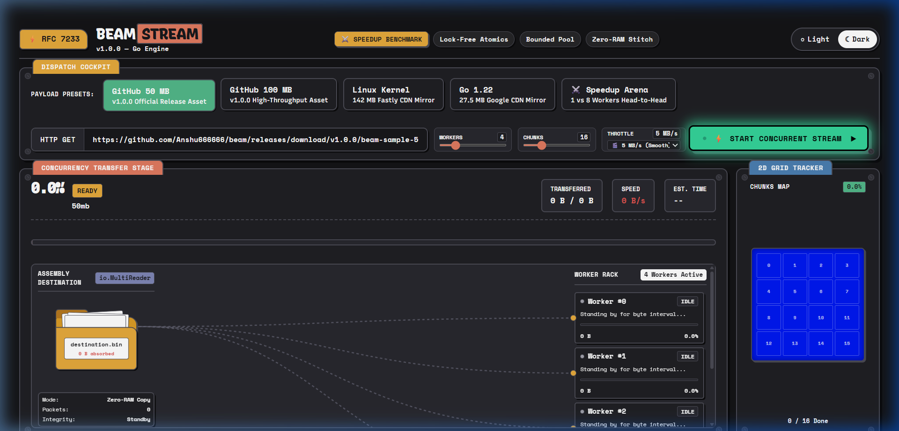
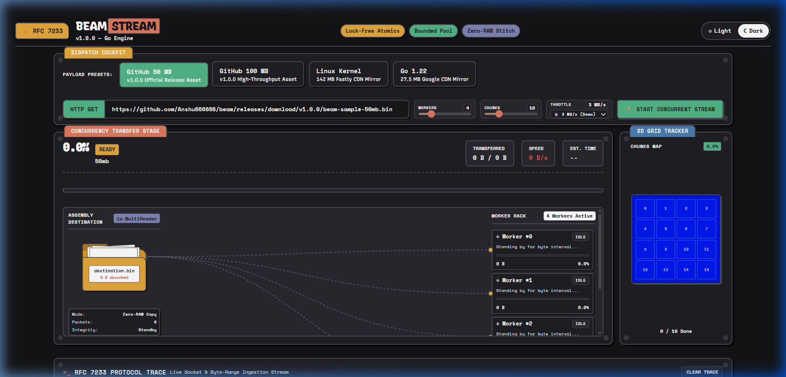
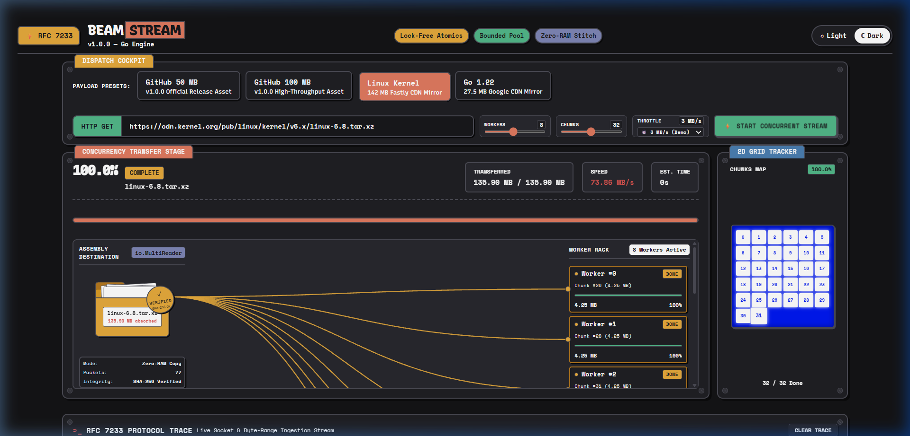
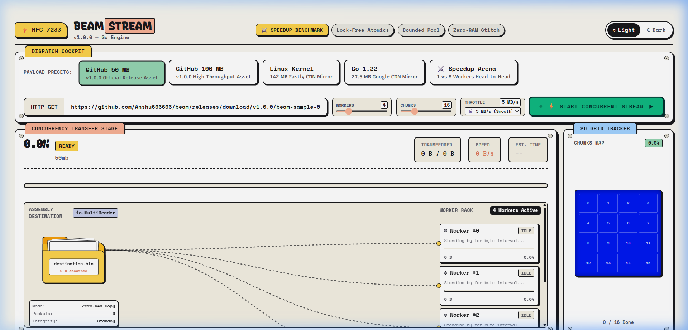
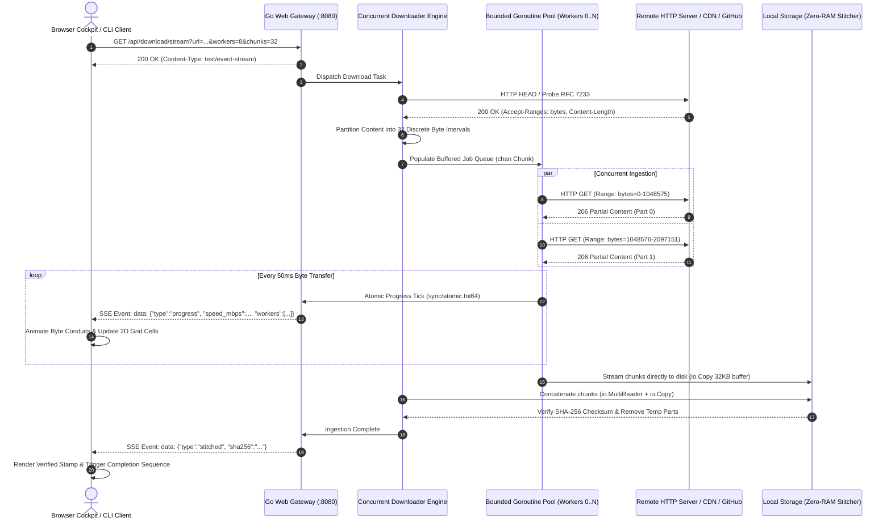

# ⚡ Beam (`beam`)

<p align="center">
  
</p>

<h3 align="center">High-Throughput Concurrent Byte-Range Streaming Engine, Bounded Goroutine Worker Pool & Lock-Free Atomic Telemetry</h3>

<p align="center">
  <a href="https://beam-stream.duckdns.org"></a>
  <a href="https://golang.org"></a>
  <a href="https://datatracker.ietf.org/doc/html/rfc7233"></a>
  <a href="https://github.com/Anshu666666/beam"></a>
  <a href="https://github.com/Anshu666666/beam"></a>
  <a href="go.mod"></a>
  <a href="LICENSE"></a>
  <a href="https://github.com/Anshu666666/beam/releases"></a>
  <a href="docker-compose.yml"></a>
  <a href="#-oracle-cloud-vm-deployment-guide"></a>
  <a href="#-verified-production-resource-footprint"></a>
</p>

<p align="center">
  <a href="#-live-web-application"><strong>🌐 Live Web Dashboard</strong></a> • 
  <a href="#-overview">Beam Overview</a> • 
  <a href="#-visual-showcase">Visual Showcase</a> • 
  <a href="#-request-lifecycle--data-flow">Request Lifecycle & Architecture</a> • 
  <a href="#-key-engineering-highlights">Key Engineering Highlights</a> • 
  <a href="#-verified-production-resource-footprint">Resource Footprint & RAM</a> • 
  <a href="#-quick-start">Quick Start</a> • 
  <a href="#-oracle-cloud-vm-deployment-guide">Oracle Cloud Deployment</a>
</p>

> [!TIP]
> ### 🌐 Live Web Application & Telemetry Cockpit
> Experience the interactive visual cockpit, Goroutine worker racks, and live Speedup Arena on our live Oracle Cloud deployment:
> - **🔒 HTTPS Domain (Let's Encrypt SSL)**: **[https://beam-stream.duckdns.org](https://beam-stream.duckdns.org)**
> - **⚡ Direct Cloud Mirror**: **[http://152.67.6.234:8080](http://152.67.6.234:8080)**

---

## 📖 Overview

Standard single-stream HTTP downloads are frequently throttled on a per-connection basis by remote servers, Content Delivery Networks (CDNs), and ISPs, severely bottlenecking high-bandwidth network pipelines. 

**`beam`** is an enterprise-grade, high-throughput concurrent file downloading engine written from scratch in Go with **zero external dependencies**. Operating similarly to low-level accelerators like `aria2` and `curl`, `beam` maximizes network utilization by:

1. **RFC 7233 Capability Probing**: Performing non-destructive HTTP `HEAD` probes to verify `Accept-Ranges: bytes` header compliance and remote payload size.
2. **Mathematical Interval Slicing**: Partitioning multi-gigabyte payloads into discrete byte ranges (`bytes=offset-limit`).
3. **Bounded Goroutine Worker Pool**: Spawning a controlled pool of concurrent worker goroutines consuming ranges from buffered channels, saturating bandwidth while preventing socket exhaustion.
4. **Lock-Free Atomic Telemetry**: Aggregating per-worker byte streams via `io.TeeReader` into cache-aligned `sync/atomic` counters for sub-millisecond progress calculation.
5. **Zero-RAM Multi-Stream Stitching**: Streaming chunk bodies directly to disk using fixed 32 KB internal buffers and concatenating them sequentially with `io.MultiReader` without holding entire files in system RAM.
6. **Real-Time Visual Cockpit**: Broadcasting live socket metrics over Server-Sent Events (SSE) to a retro-editorial cyberpunk command dashboard.

---

## 📷 Visual Showcase

### 1. Live Concurrency Arena & Stream Telemetry (Dark Mode)
Real-time aggregate throughput monitoring (`MB/s`), worker Goroutine progress tracks, animated byte packet conduits, and zero-RAM assembly folder with SHA-256 seal verification.

<p align="center">
  
</p>

---

### 2. Dispatch Cockpit & Token-Bucket Bandwidth Limiter
Quick-select real-world CDN payloads (GitHub Release Assets, Linux Kernel Fastly CDN, Go Dev Mirror), parametric worker/chunk sliders, and built-in Token Bucket throttling (1 MB/s, 3 MB/s, 5 MB/s, 10 MB/s, Max).

<p align="center">
  
</p>

---

### 3. 2D Discrete Chunk Matrix & Cryptographic Seal Verification
Compact defrag-style chunk visualizer tracking discrete states (Idle `0`, Downloading `⚡`, Completed `✓`) alongside final cryptographic SHA-256 integrity validation.

<p align="center">
  
</p>

---

### 4. High-Contrast Retro Light Mode
Neo-brutalist tactile chassis with protruding folder tabs, recessed card bezels, and spring micro-interactions for bright ambient workstations.

<p align="center">
  
</p>

---

## 🔄 Request Lifecycle & Data Flow



---

## ✨ Key Engineering Highlights

### ⚡ Lock-Free Atomic Progress Engine
- Decouples UI polling and progress calculation from worker synchronization.
- Workers pipe raw incoming socket streams through `io.TeeReader` into dedicated `WorkerTracker` instances.
- Writes atomically increment chunk progress and aggregate counters using lock-free `sync/atomic.Int64.Add`, eliminating mutex contention across high core counts.


### 📊 Verified Production Resource Footprint
Measured live on an **Oracle Cloud Infrastructure (OCI) Always-Free VM** (`152.67.6.234` running Ubuntu Linux `x86_64`):

| Metric | Production Measurement | Technical Significance |
|---|---|---|
| **Physical RAM (`VmRSS`)** | **7,296 kB (~7.1 MB)** | Actual resident physical memory occupied in system RAM |
| **Systemd CGroup Memory** | **8.6 MB (Peak: 9.0 MB)** | Total memory consumed including stack, heap, and runtime buffers |
| **VM Memory Utilization** | **0.7% of 1 GB RAM** | Leaves 99.3% of VM memory completely free for other microservices (e.g. `shieldApi`, Redis) |
| **Idle CPU Utilization** | **0.0%** | Event-driven Goroutines sleep efficiently with zero CPU polling |
| **Daemon Startup Time** | **< 2 milliseconds** | Zero runtime initialization overhead or JIT/V8 warmup delays |

#### Live Commands to Monitor Memory Consumption on the VM
```bash
# 1. Quick systemd memory status (Shows current & peak memory)
ssh -i "path/to/key.key" ubuntu@152.67.6.234 "systemctl status beam.service"

# 2. Process table inspection (Shows exact RSS in KB and %MEM)
ssh -i "path/to/key.key" ubuntu@152.67.6.234 "ps -o pid,user,%cpu,%mem,rss,comm -C beam-web"

# 3. Direct Linux Kernel memory metrics (/proc)
ssh -i "path/to/key.key" ubuntu@152.67.6.234 "grep -E 'VmRSS|VmPeak' /proc/\$(pidof beam-web)/status"
```

### 🛡️ Zero-RAM Streaming Architecture
- Avoids accumulating massive file payloads in process heap memory.
- Incoming chunk streams are flushed immediately to temporary files via Go's standard `io.Copy`, operating on an internal fixed **32 KB buffer**.
- System memory utilization remains flat (~15 MB - 25 MB RSS) regardless of whether downloading a 10 MB archive or a 50 GB disk image.

### 🧵 Bounded Concurrency Worker Pool
- Decouples the number of mathematical chunk intervals from operating system thread and network socket consumption.
- Chunks are distributed over a buffered Go channel (`chan Chunk`). A bounded pool (e.g. 4 or 8 workers) consumes chunks sequentially, eliminating socket exhaustion and CDN rate-limit tripping.

### 🧮 2D Discrete Chunk Matrix Visualizer
- Minimal-footprint retro defrag visualizer showing real-time chunk transitions.
- Dynamically scales its CSS grid geometry to fit any chunk count (4 to 64 chunks) without DOM recreation, keeping frontend rendering butter-smooth at 60 FPS.

### ⏱️ Token-Bucket Bandwidth Throttling
- Integrated rate limiter using standard Go time tick tokens.
- Supports throttling transfers at slow (1 MB/s), demo (3 MB/s), smooth (5 MB/s), or max bandwidth speeds, enabling controlled demonstrations and network congestion testing.

### 🪢 Zero-RAM Multi-File Stitching
- Assembles parts using virtual stream concatenation via `io.MultiReader`.
- All temporary chunk handles are explicitly closed prior to unlinking, guaranteeing clean execution on Windows without OS file-lock exceptions.

### 🔄 Automatic Single-Stream Fallback
- If a target endpoint lacks RFC 7233 range support or returns a 200 OK without `Accept-Ranges`, `beam` seamlessly drops to a single-stream fallback while preserving full live telemetry.

---

## 🏗️ Repository Architecture

```
beam/
├── assets/                          # High-resolution documentation screenshots
│   ├── hero_dashboard_dark.png     # Live stream telemetry dashboard
│   ├── cockpit_standby_dark.png    # Dispatch cockpit & preset controls
│   ├── transfer_verified_dark.png  # Verified seal & completed 2D matrix
│   └── cockpit_light_mode.png      # Neo-brutalist light theme showcase
├── cmd/
│   └── web/                        # Web Dashboard Server entrypoint
│       └── main.go                 # HTTP server, SSE endpoint, static file server
├── downloader/                     # Core Concurrent Engine Package
│   ├── downloader.go               # Orchestrator, Range calculator, Probe logic
│   ├── worker.go                   # Goroutine pool worker, HTTP Range client
│   ├── stitcher.go                 # io.MultiReader zero-RAM file assembler
│   ├── progress.go                 # Lock-free sync/atomic progress tracker
│   └── rate_limiter.go             # Token-bucket bandwidth limiter
├── web/
│   └── static/                     # Embedded Web Cockpit Assets
│       ├── index.html              # Cockpit layout & chassis frame
│       ├── style.css               # Neo-brutalist dual-theme design system
│       ├── app.js                  # SSE client & 2D Matrix state manager
│       └── anime.min.js            # Particle physics motion engine
├── Dockerfile                       # Multi-stage production container build
├── docker-compose.yml               # 1-command microservice orchestration
├── go.mod                           # Go module manifest (Zero external dependencies)
├── main.go                          # CLI application entrypoint
└── main_test.go                     # Data-race & cryptographic integrity tests
```

---

## 🚀 Quick Start

### Prerequisites
- [Go 1.22+](https://golang.org/dl/) (or [Docker](https://www.docker.com/) if running containerized)
- [Git](https://git-scm.com/)

### 1. Clone the Repository
```bash
git clone https://github.com/Anshu666666/beam.git
cd beam
```

---

### Option A: Launch the Web Cockpit (Recommended)
```bash
# Start the Go web server on port 8080
go run ./cmd/web -port 8080
```
Open **`http://localhost:8080`** in your browser.

---

### Option B: Run via Docker Compose
```bash
# Build and run the lightweight container in the background
docker compose up -d

# View live container logs
docker compose logs -f
```
The web dashboard is instantly accessible at **`http://localhost:8080`**.

---

### Option C: CLI Mode
```bash
# Fast download with 8 concurrent workers and 16 chunks
go run ./main.go -url https://cdn.kernel.org/pub/linux/kernel/v6.x/linux-6.8.tar.xz -w 8 -c 16

# Custom output file
go run ./main.go -url https://example.com/payload.zip -o my_file.zip -w 4 -c 8
```

#### CLI Command Flags
| Flag | Type | Default | Description |
|---|---|---|---|
| `-url` | `string` | *(Required)* | Remote target file URL to download |
| `-o` | `string` | Auto-derived | Destination file path on local disk |
| `-w` | `int` | `4` | Number of concurrent worker Goroutines |
| `-c` | `int` | `4` | Number of discrete byte-range chunks |

---

## ☁️ Oracle Cloud VM Deployment Guide

Because Oracle Cloud VMs run Linux (Ubuntu or Oracle Linux), the Windows `.exe` binary cannot run natively. However, deploying `beam` to an Oracle VM is fast and requires minimal effort:

### Method 1: Docker Container Deployment (Recommended)
1. **Connect to your Oracle VM via SSH**:
   ```bash
   ssh -i "path/to/your/ssh-key.key" ubuntu@<YOUR_ORACLE_VM_PUBLIC_IP>
   ```

2. **Clone and run with Docker Compose**:
   ```bash
   git clone https://github.com/Anshu666666/beam.git
   cd beam
   docker compose up -d --build
   ```

3. **Open Ingress Rules on Oracle Cloud**:
   - Go to **OCI Console** -> **Networking** -> **Virtual Cloud Networks (VCN)**.
   - Click on your Subnet's **Default Security List** -> **Add Ingress Rules**.
   - Source: `0.0.0.0/0`, Protocol: `TCP`, Destination Port: `8080`.
   - On the VM terminal, open the host firewall:
     ```bash
     sudo iptables -I INPUT 6 -m state --state NEW -p tcp --dport 8080 -j ACCEPT
     sudo netfilter-persistent save
     ```

---

### Method 2: Direct Standalone Linux Binary (Zero Docker Required)
Because `beam` has zero CGO or external dependencies, you can run the pre-compiled standalone Linux binary directly:

1. **Upload the Linux binary and web assets to your VM**:
   ```bash
   # For standard x86_64 AMD shapes:
   scp -i "your-key.key" beam-web-linux-amd64 ubuntu@<VM_IP>:~/beam-web
   
   # For Oracle Always Free ARM64 Ampere A1 shapes:
   scp -i "your-key.key" beam-web-linux-arm64 ubuntu@<VM_IP>:~/beam-web

   # Copy the web assets:
   scp -i "your-key.key" -r web ubuntu@<VM_IP>:~/web
   ```

2. **Run as a background systemd service**:
   ```bash
   # On the VM:
   chmod +x ~/beam-web
   nohup ./beam-web -port 8080 > beam.log 2>&1 &
   ```

---

## 🧪 Testing & Data Race Verification

`beam` is thoroughly tested using Go's built-in race detector and synthetic in-memory test servers (`net/http/httptest`), requiring zero internet access during tests:

```bash
# Run all unit and integration tests with the Go race detector enabled
go test -v -race ./...
```

All test suites verify:
- ✅ **Zero Data Races**: Guaranteed thread safety across concurrent goroutine pools.
- ✅ **Cryptographic SHA-256 Integrity**: Chunk reassembly exactly matches original bytes.
- ✅ **Graceful Fallback**: Verified handling of non-range-supporting endpoints.
- ✅ **Zero Memory Leaks**: Proper closing of temporary file descriptors.

---

## 📄 License

This project is licensed under the **MIT License** — see the [LICENSE](LICENSE) file for details.
