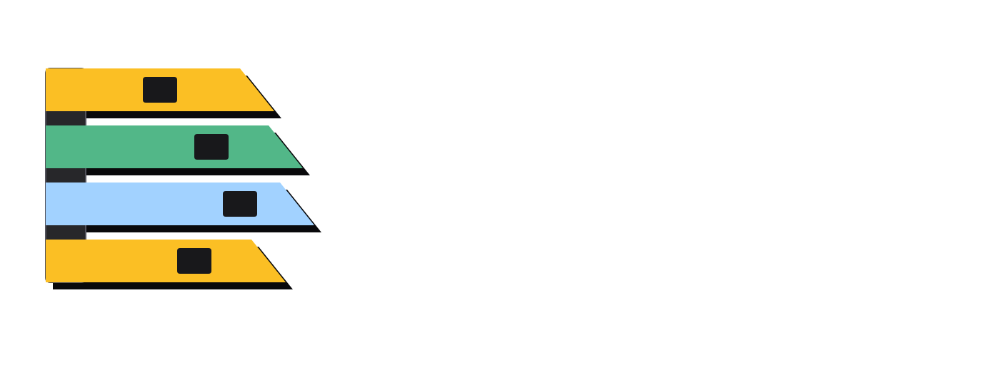
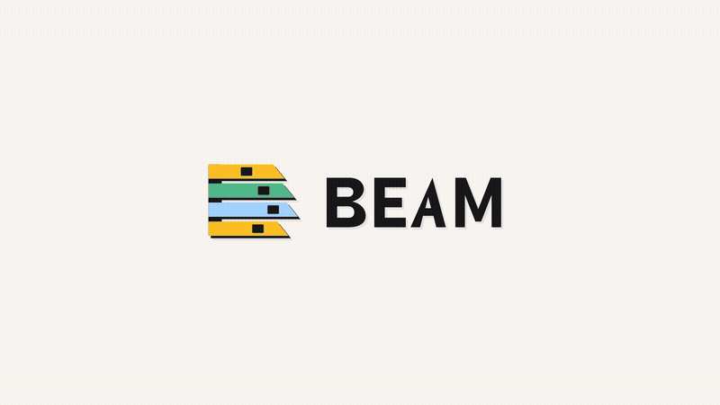
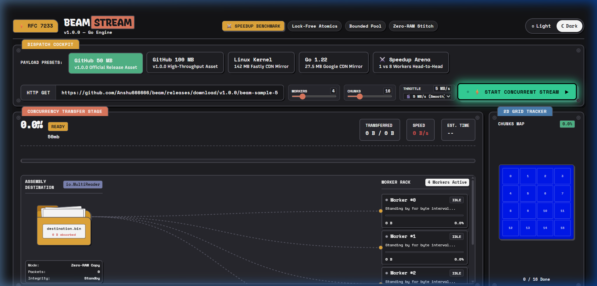
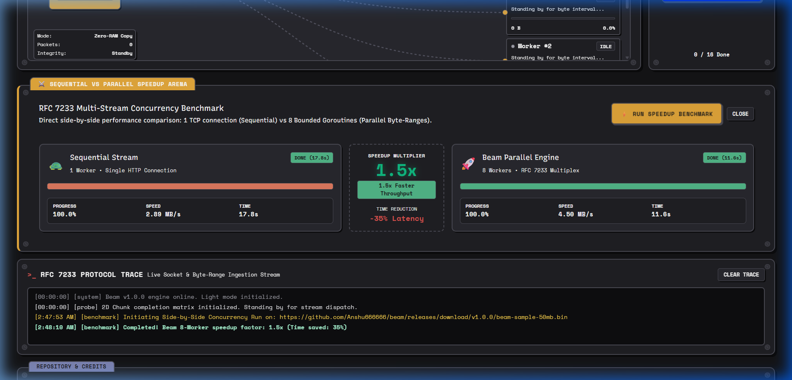
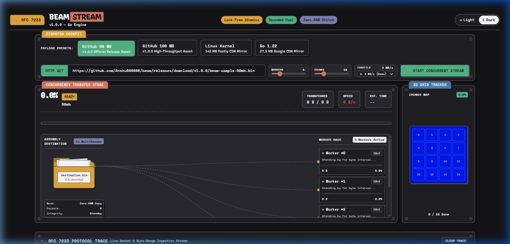
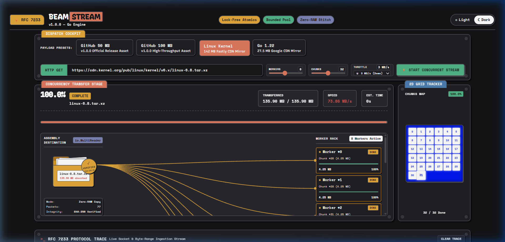
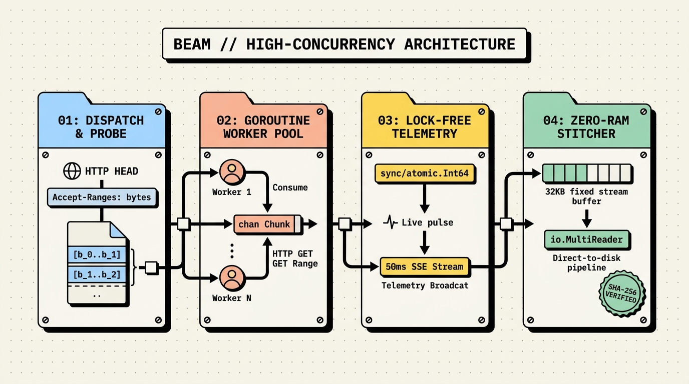
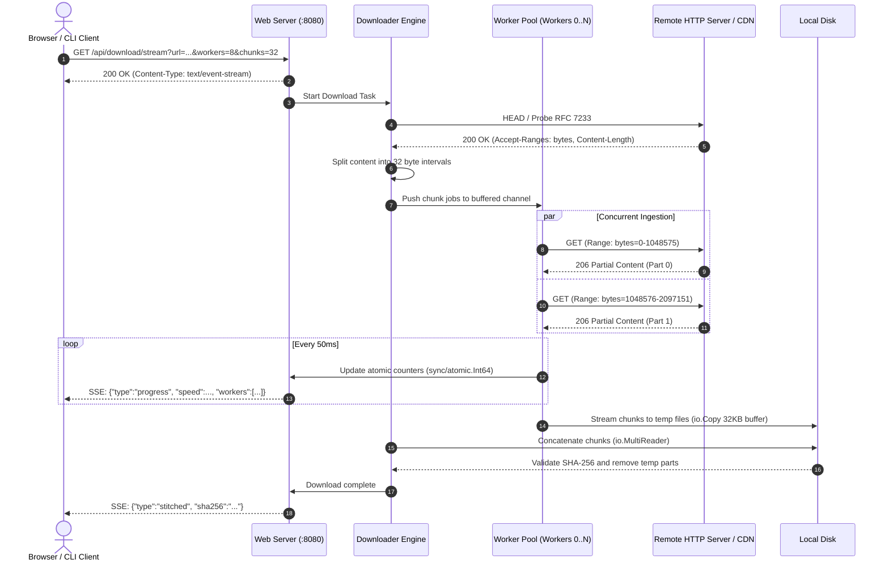

<p align="center">
  <a href="https://github.com/Anshu666666/beam">
    <picture>
      <source media="(prefers-color-scheme: dark)" srcset="assets/brand/beam-logo-dark.png">
      <source media="(prefers-color-scheme: light)" srcset="assets/brand/beam-logo-light.png">
      
    </picture>
  </a>
</p>

<h3 align="center">High-Throughput Concurrent RFC 7233 Byte-Range Streaming Engine &amp; Visual Cockpit in Pure Go</h3>

<p align="center">
  <a href="https://golang.org"></a>
  <a href="https://datatracker.ietf.org/doc/html/rfc7233"></a>
  <a href="#-performance--memory"></a>
  <a href="LICENSE"></a>
</p>

<p align="center">
  <a href="https://github.com/Anshu666666/beam/releases/download/v1.0.0/beam-explainer.mp4">
    
  </a>
</p>

<p align="center">
  <a href="https://github.com/Anshu666666/beam/releases/download/v1.0.0/beam-explainer.mp4"><b>▶ Click to watch the full 1080p Explainer Video with Voiceover (25.5s MP4)</b></a>
</p>

<p align="center">
  <a href="#-live-demo">Live Demo</a> •
  <a href="#-how-it-works">How It Works</a> •
  <a href="#-visual-showcase">Visual Showcase</a> •
  <a href="#-architecture">Architecture</a> •
  <a href="#-key-features">Key Features</a> •
  <a href="#-performance--memory">Performance</a> •
  <a href="#-quick-start">Quick Start</a>
</p>

---

## 🌐 Live Demo

An interactive deployment is live at **[https://beam-stream.duckdns.org](https://beam-stream.duckdns.org)**.

---

## 📖 How It Works

Single-stream HTTP downloads often fail to saturate available bandwidth because remote servers, CDNs, or network routes throttle throughput per connection. 

`beam` accelerates downloads by splitting target files into chunks and fetching them in parallel using standard HTTP `Range` headers ([RFC 7233](https://datatracker.ietf.org/doc/html/rfc7233)). It is written in Go with **zero third-party dependencies**.

```
1. Probe        HEAD request checks for Accept-Ranges: bytes and Content-Length.
2. Slice        Divides total byte length into N discrete intervals.
3. Queue        Places chunk jobs into a buffered Go channel.
4. Stream       A pool of worker goroutines fetches ranges concurrently to disk.
5. Track        Atomic counters calculate real-time speeds with no lock contention.
6. Assemble     Stitches chunks sequentially with io.MultiReader (32 KB buffer).
7. Verify       Computes the SHA-256 checksum of the finished file.
```

If a server does not support byte ranges, `beam` automatically falls back to a standard single download while still providing full live telemetry.

---

## 📷 Visual Showcase

### 1. Live Download Arena (Dark Mode)
Real-time aggregate throughput (`MB/s`), per-worker progress tracks, and file assembly state.

<p align="center">
  
</p>

---

### 2. Sequential vs. Parallel Speedup Arena
Head-to-head comparison between a standard 1-connection download and Beam's 8-worker parallel engine on live CDN files.

<p align="center">
  
</p>

---

### 3. Dispatch Controls & Rate Limiter
Preset test targets (GitHub Releases, Linux Kernel Fastly CDN, Go dev mirror), custom worker/chunk sliders, and bandwidth limits (1 MB/s, 3 MB/s, 5 MB/s, Max).

<p align="center">
  
</p>

---

### 4. Chunk Matrix & Integrity Verification
Visual grid tracking each chunk's state (Idle, Downloading, Complete) with final SHA-256 checksum verification.

<p align="center">
  
</p>

---

## 🔄 Architecture

<p align="center">
  
</p>

<details>
<summary><strong>View Protocol Request Lifecycle (Mermaid Trace)</strong></summary>



</details>

---

## ✨ Key Features

- **Bounded Worker Pool**: Decouples chunk counts from thread creation. 32 chunks can be fetched smoothly across 4 or 8 workers without exhausting sockets or hitting CDN rate limits.
- **Low Memory Usage**: Streams chunks to temporary files using standard 32 KB copy buffers. Memory consumption remains low (~7–15 MB RSS) whether downloading a 10 MB file or a 50 GB disk image.
- **Lock-Free Atomic Telemetry**: Per-worker byte counts update using `sync/atomic.Int64.Add`. The 50ms SSE broadcast loop reads counters directly without locking worker goroutines.
- **Stream Concatenation**: Reassembles finished parts sequentially using `io.MultiReader` into the final destination file, cleaning up temporary parts immediately.
- **Token-Bucket Rate Limiting**: Built-in bandwidth throttle for testing network congestion and steady-state demonstrations.
- **Automatic Fallback**: Gracefully defaults to single-stream download if the remote host doesn't support HTTP range requests.
- **Zero External Dependencies**: Uses only standard Go libraries (`net/http`, `sync/atomic`, `io`, `crypto/sha256`).

---

## 📊 Performance & Memory

Tested on a cloud instance (1 vCPU, 1 GB RAM, Ubuntu Linux):

| Metric | Measurement | Note |
|---|---|---|
| **Physical RAM (`VmRSS`)** | **~7.2 MB** | Resident physical memory during active download |
| **CGroup Memory** | **8.6 MB** (peak 9.0 MB) | Total process footprint under systemd |
| **Idle CPU** | **0.0%** | Event-driven goroutines sleep when idle |
| **Startup Time** | **< 2 ms** | Compiled static binary, no runtime warmup |

Inspect live metrics with:
```bash
# Check service memory footprint
systemctl status beam.service

# Inspect process RSS in KB
ps -o pid,user,%cpu,%mem,rss,comm -C beam-web
```

---

## 🏗️ Repository Structure

```
beam/
├── cmd/
│   └── web/                   # Web dashboard entrypoint
│       └── main.go            # HTTP server, static asset handler & SSE stream
├── downloader/                # Core concurrent engine
│   ├── chunk.go               # Chunk calculation and definitions
│   ├── chunk_download.go      # HTTP range request execution
│   ├── client.go              # HTTP client configuration
│   ├── downloader.go          # Download orchestrator and coordination
│   ├── limiter.go             # Token-bucket rate limiter
│   ├── pool.go                # Bounded goroutine worker pool
│   ├── probe.go               # RFC 7233 HEAD probe
│   ├── progress.go            # Lock-free atomic progress tracking
│   └── stitch.go              # Zero-RAM file assembly & SHA-256 verification
├── web/
│   ├── server.go              # HTTP server and SSE streaming logic
│   └── static/                # Static frontend assets (HTML, CSS, JS)
├── Dockerfile                  # Lightweight Alpine container build
├── docker-compose.yml          # Container configuration
├── go.mod                      # Module definition (zero external dependencies)
├── main.go                     # CLI entrypoint
└── main_test.go                # Integration & concurrency tests
```

---

## 🚀 Quick Start

### 📦 Standalone Binaries (No Go or Docker Required)

Grab the precompiled static binary for your OS directly from [Release v1.0.0](https://github.com/Anshu666666/beam/releases/tag/v1.0.0):

| OS | Architecture | Binary |
|---|---|---|
| **Windows** | 64-bit (x86_64) | [**beam.exe** (direct download)](https://github.com/Anshu666666/beam/releases/download/v1.0.0/beam.exe) |
| **macOS** | Apple Silicon (arm64) | [**beam-darwin-arm64**](https://github.com/Anshu666666/beam/releases/download/v1.0.0/beam-darwin-arm64) |
| **Linux** | 64-bit (x86_64) | [**beam-linux-amd64**](https://github.com/Anshu666666/beam/releases/download/v1.0.0/beam-linux-amd64) |

```bash
# Instant demo download test (50 MB sample file, 8 workers, 16 chunks):
.\beam.exe -demo

# Download a large file with 8 workers and 16 chunks:
.\beam.exe -url "https://releases.ubuntu.com/24.04/ubuntu-24.04.5.1-desktop-amd64.iso" -w 8 -c 16

# Direct positional URL syntax:
.\beam.exe https://releases.ubuntu.com/24.04/ubuntu-24.04.5.1-desktop-amd64.iso -w 8 -c 16

# Show help menu with visual banner and examples:
.\beam.exe -help

# Linux / macOS (make executable first):
chmod +x ./beam-*
./beam-* -demo
```

---

### Prerequisites (For Building from Source)
- [Go 1.22+](https://golang.org/dl/) (or [Docker](https://www.docker.com/))
- [Git](https://git-scm.com/)

### Clone the Repository
```bash
git clone https://github.com/Anshu666666/beam.git
cd beam
```

### Option A: Launch the Web Dashboard (Recommended)
```bash
go run ./cmd/web -port 8080
```
Open **`http://localhost:8080`** in your browser.

### Option B: Run via Docker
```bash
docker compose up -d
```
The dashboard will be available at **`http://localhost:8080`**.

### Option C: CLI Mode
```bash
# Download using 8 workers and 16 chunks
go run ./main.go -url https://cdn.kernel.org/pub/linux/kernel/v6.x/linux-6.8.tar.xz -w 8 -c 16

# Download to a custom output file
go run ./main.go -url https://example.com/file.zip -o my_file.zip -w 4 -c 8
```

#### CLI Flags
| Flag | Default | Description |
|---|---|---|
| `-url` | *(Required)* | URL of the file to download (or pass as positional argument) |
| `-demo` | `false` | Run an instant demonstration download using the 50 MB sample asset |
| `-o` | Auto-derived | Destination file path on disk |
| `-w` | `4` | Number of concurrent worker goroutines in the pool |
| `-c` | `4` | Number of byte-range chunks to partition the file into |
| `-v` / `-version` | `false` | Print engine version and exit |
| `-help` | `false` | Display full interactive help menu and copy-pasteable examples |

---

## 🧪 Testing

Run unit, integration, and race detection tests:

```bash
go test -v -race ./...
```

Tests cover:
- Thread safety across concurrent worker pools (`-race`)
- Accurate range slicing and edge case boundaries
- Chunk reassembly and SHA-256 cryptographic verification
- Single-stream fallback behavior
- Clean file handle release and temporary file cleanup

---

## 📄 License

This project is licensed under the [MIT License](LICENSE).
